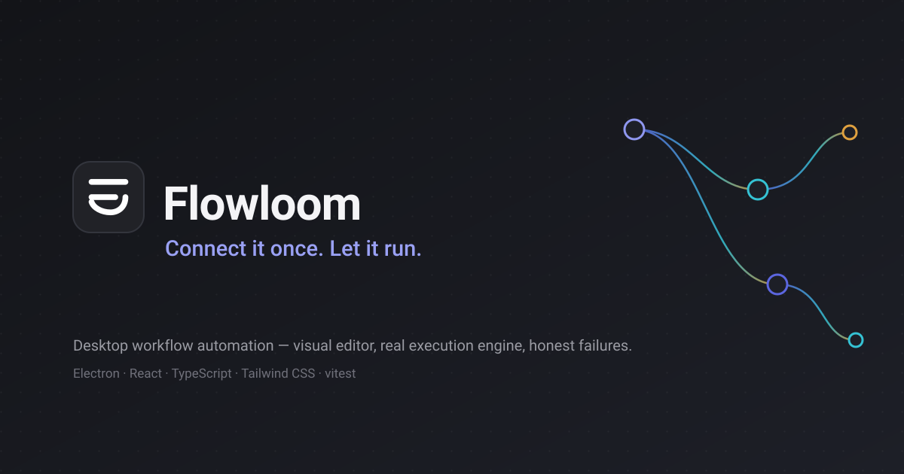
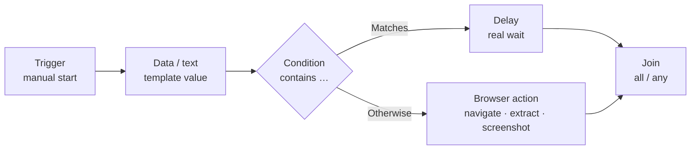

<p align="center">
  
</p>

<h1 align="center">Flowloom</h1>

<p align="center">
  <strong>Connect it once. Let it run.</strong>
</p>

<p align="center">
  A desktop workflow-automation app: design workflows on a visual canvas, execute them with a real
  deterministic engine, and plug in browser automation, model generation, and spoken run feedback —
  all running locally on your machine.
</p>

<p align="center">
  <a href="https://www.electronjs.org/"></a>
  <a href="https://react.dev/"></a>
  <a href="https://www.typescriptlang.org/"></a>
  <a href="https://tailwindcss.com/"></a>
  <a href="https://vitest.dev/"></a>
</p>

<p align="center">
  <a href="#what-is-flowloom">What is Flowloom?</a> ·
  <a href="#at-a-glance">At a glance</a> ·
  <a href="#how-it-works">How it works</a> ·
  <a href="#quick-start">Quick start</a> ·
  <a href="#configuration-and-environment-variables">Configuration</a> ·
  <a href="#your-first-workflow">First workflow</a> ·
  <a href="#project-architecture">Architecture</a> ·
  <a href="#integrations-and-providers">Integrations</a> ·
  <a href="#development-commands">Commands</a> ·
  <a href="#contributing">Contributing</a>
</p>

---

## What is Flowloom?

Most automation tools force a choice: a browser-only toy that can't run code you trust, or a
developer framework that demands you write glue for every step. Flowloom sits in between. It is a
native **desktop application** where you assemble a workflow from typed, validated steps on a
visual canvas — trigger, text, delay, condition, join, browser action, model generation — and run
it with a real engine that executes those steps deterministically, reports exactly what happened,
and refuses to lie about what it didn't do.

Flowloom is for developers, tinkerers, and automation-minded people who want:

- a **visual editor** that persists every graph, pan, and zoom exactly as you left it;
- an **execution engine** that runs in the main process with honest statuses, real cancellation,
  branching, joins, and per-node timelines — no fake progress bars;
- **integrations you configure once**: Browserbase for real remote-browser steps, ElevenLabs for
  spoken run feedback, Paper Instruments (Ultramarine API) for bounded model generation;
- **local-first data**: workflows, run history, and artifacts live in your Electron `userData`
  directory. Nothing is uploaded anywhere except the calls you explicitly configure.

Honesty is a design constraint here. A browser step that can't find a selector says so; a run that
fails names the node that failed; an unconfigured provider refuses before any request is made rather
than substituting something plausible. Empty states are truthful, and there is no fake data
anywhere in the app.

**What runs today:** the visual editor, workflow persistence, the deterministic execution engine
(trigger / data / delay / condition / join), real Browserbase sessions (navigate, extract, click,
fill, wait, screenshot), Paper Instruments generation, run history with search/filter/delete/clear,
and optional ElevenLabs narration.

## At a glance

| Capability | What it actually does | Status |
| --- | --- | --- |
| Visual workflow editor | Drag-and-drop canvas (`@xyflow/react`), undo/redo, node library, per-node inspector, autosave (~500 ms debounce) with zoom/pan restore | ✅ Implemented |
| Workflow persistence | One JSON file per workflow + index under `<userData>/workflows/`; validated in the main process before every save | ✅ Implemented |
| Execution engine | Promise-graph scheduler, deterministic branching, real cancellation, 3-run concurrency cap, one run per workflow | ✅ Implemented |
| Trigger node | Manual start; per-run metadata, race-free | ✅ Implemented |
| Data / text node | Holds a value; `{{stepId}}` templates resolve against *finished* upstream outputs (no `eval`, 64 KB payload cap) | ✅ Implemented |
| Delay node | Real cancellable wait, 1–3600 seconds | ✅ Implemented |
| Condition node | Six deterministic operators (`contains`, `doesNotContain`, `equals`, `notEquals`, `isEmpty`, `isNotEmpty`) with `Matches` / `Otherwise` branches | ✅ Implemented |
| Join node | `all` (wait for every branch) and `any` (first success wins) | ✅ Implemented |
| Browser action node | Real Browserbase sessions over CDP: `navigate`, `extractPageText`, `extractText`, `click`, `fillField`, `waitFor`, `pageInfo`, `screenshot` | ✅ Implemented (live-verified) |
| Model generation node | Paper Instruments chat completions with bounded tokens, optional JSON-schema-subset validation, honest usage numbers | ✅ Implemented (live-verified) |
| Cancellation | Real cancel: timers cleared immediately, pending nodes marked `cancelled`, terminal state never rewritten to success | ✅ Implemented |
| Run history | Newest-first list, node-level timelines, browser/model metadata, search, status filters, per-run delete and clear-all, 200-run retention | ✅ Implemented |
| Voice feedback | Optional ElevenLabs narration of run started/succeeded/failed/cancelled and browser-step completion; mute toggle during runs | ✅ Implemented (off by default) |
| Language engine settings | Google AI / OpenRouter / Ollama connection tests with per-section credential storage | ✅ Settings implemented · **no workflow node yet** |
| Artifact store | Screenshots stored under `<userData>/artifacts/`, surfaced only through one validated IPC (renderer never sees a filesystem path) | ✅ Implemented |
| Automatic retries | Nothing is silently retried anywhere | ⛔ By design (not present) |
| Packaged installers | No `electron-builder`/installer pipeline | ⛔ Not present (run from source or `out/`) |

## How it works :

Flowloom separates the **canvas** (what you designed) from the **engine** (what actually runs).
The renderer never executes a step itself. When you press **Run**:

1. The dirty graph is saved first — the engine executes exactly the persisted record; a failed save
   refuses to start.
2. The main process independently re-validates the record: structure (acyclic, no dangling edges,
   known types), per-node configuration completeness, trigger connectivity, and reachability.
   Problems come back as actionable, per-node messages before any side effect occurs.
3. Credential gates run before side effects too — a workflow containing a browser step without
   Browserbase credentials is refused before a session is ever created.
4. The scheduler builds one deferred promise per edge. A node runs when all its incoming edges are
   terminal; a `join: any` node proceeds on the first success; fully-skipped branches skip
   downstream instead of deadlocking joins.
5. Each finished node publishes its output (size-capped, secret-redacted) to downstream steps.
   `{{stepId}}` references in text fields resolve against finished upstream outputs only.
6. Every transition is streamed to the renderer over a push channel and written to run history
   incrementally (atomic temp+rename, serialized writes).
7. Cancellation flips a per-run signal: delay timers clear immediately, pending nodes become
   `cancelled`, and the terminal state is final.



*A real example assembled entirely from implemented node types.* Everything in this diagram exists
today; it is illustrative of one shape, not a required pattern.

## Quick start

**Prerequisites**

- **Node.js 22** (this is the version the project is developed and verified on; see
  [`package.json`](package.json) — no `engines` field is declared, so other recent Node versions
  may work but are untested here).
- **npm** (the lockfile is npm's).
- On **headless Linux**, running the packaged app or the smoke test needs `xvfb-run` (the smoke
  script wraps itself automatically).
- Internet access is only required when a workflow step (or a Settings connection test) actually
  calls a provider. The editor, engine, and local node types run fully offline.

**Install and run in development**

```bash
git clone https://github.com/maisamabbas0323/flowloom.git
cd flowloom
npm install        # installs dependencies (Electron binary included)
npm run dev        # starts electron-vite in dev mode with hot reload
```

**Production build**

```bash
npm run build      # electron-vite build → out/main, out/preload, out/renderer
npm start          # electron-vite preview: runs the built app
```

Build artifacts land in `out/`:

| Artifact | Path |
| --- | --- |
| Electron main entry | `out/main/index.js` |
| Preload bridge | `out/preload/index.js` |
| Renderer bundle | `out/renderer/` |

There is currently **no installer/packaging pipeline** (no `electron-builder`); the app is run
either via `npm run dev`, `npm start`, or directly with Electron against `out/main/index.js`.

> **Note on `npm install`:** the Electron postinstall downloads a platform binary from GitHub
> releases. On networks where that CDN stalls, the download can crawl — if it does, see
> [Troubleshooting](#troubleshooting).

## Configuration and environment variables

Flowloom reads provider configuration from two places, in a strict, documented order:

> **Saved Settings override → `.env` file → the one documented default**

Settings values always win. Clearing a saved override in the app re-exposes the `.env` value. The
`.env` file itself is never written or modified by the app. `.env` lookup order:
`FLOWLOOM_ENV_PATH` → `<userData>/.env` → `<cwd>/.env` (for unpackaged runs such as dev).

Copy the template to get started:

```bash
cp .env.example .env
```

[`.env.example`](.env.example) documents every recognized variable. Secrets (API keys) are stored
encrypted with the OS credential store (`safeStorage`) in `<userData>/secrets.json`; **values are
never sent to the renderer process and never logged**. If the OS has no secure storage available,
keys are held session-only rather than written to disk unencrypted.

### Language engine — Google AI, OpenRouter, Ollama

| Variable | Purpose |
| --- | --- |
| `FLOWLOOM_MODEL_PROVIDER` | `google` \| `openrouter` \| `ollama` |
| `FLOWLOOM_MODEL_ID` | The **exact** model id your provider supplies. Flowloom never guesses or invents one. |
| `GOOGLE_API_KEY` | Google AI Studio key — [aistudio.google.com](https://aistudio.google.com) |
| `OPENROUTER_API_KEY` | OpenRouter key — [openrouter.ai](https://openrouter.ai) |
| `OLLAMA_BASE_URL` | Local Ollama server, default `http://127.0.0.1:11434` |
| `OLLAMA_API_KEY` | Optional; only if your Ollama endpoint requires auth |

These providers are **configured and connection-tested** in Settings (the test runs a real,
provider-specific read against the API). Ollama is local inference — it requires a running Ollama
server on your machine and uses its own resources. Google and OpenRouter are hosted APIs that
require internet access and may cost money.

> **Honest scope:** these three providers are *not yet wired into a workflow node*. The model node
> that executes inside workflows today is Paper Instruments (below). This is stated deliberately —
> there is no hidden or half-working language-engine step.

### Browserbase — real browser automation

| Variable | Purpose |
| --- | --- |
| `BROWSERBASE_API_KEY` | API key — [browserbase.com](https://www.browserbase.com) |
| `BROWSERBASE_PROJECT_ID` | Project id; verified by the API when a session is created |

Used by the **browser action** node. Each browser action runs in its own remote session; supported
operations are `navigate`, `extractPageText`, `extractText`, `click`, `fillField`, `waitFor`,
`pageInfo`, and `screenshot`. The Settings "Test connection" is **free** — a read-only
`GET /v1/sessions`, no session created, no credits spent. Running workflows with browser steps
creates real, billable Browserbase sessions. Navigation is restricted by a URL policy
(http/https only; no loopback, private-range, link-local, or cloud-metadata hosts; no embedded
credentials; redirect destination re-checked) — see [Security and Privacy](#security-and-privacy)
for its honest limits.

### ElevenLabs — spoken run feedback

| Variable | Purpose |
| --- | --- |
| `ELEVENLABS_API_KEY` | API key — [elevenlabs.io](https://elevenlabs.io) |
| `ELEVENLABS_VOICE_ID` | The voice id to speak with |

Powers **Test Voice** and the optional narration layer: run started / succeeded / failed /
cancelled, plus finished browser steps. Narration is **off by default**, generates one short clip
per real event (no retries — credits are never spent twice for one event), and is spoken by the
renderer's audio element. Settings "Test Voice" performs one real generation; that consumes
ElevenLabs credits.

### Paper Instruments — Ultramarine model API

| Variable | Purpose |
| --- | --- |
| `PAPERINSTRUMENTS_API_KEY` | Live key, format `pi_live_…` — [paperinstruments.com](https://paperinstruments.com) |
| `PAPERINSTRUMENTS_MODEL` | The exact model id from `GET /v1/models`. Never guessed. |

Powers the **`paperInstruments` workflow node** and its Settings section. The documented HTTP
chat-completions surface is used (`POST /v1/chat/completions`, non-streaming), with bounded
`max_completion_tokens`, optional JSON-object output validated against a documented JSON-Schema
*subset*, and the provider's own usage numbers reported verbatim in run history. The Settings
connection test is **free** (three unbilled GETs: `/v1/models`, model lookup, `/v1/usage`); a
billable generation only happens on an explicit button press. An optional local spending stop
(`paper.minBalanceUsd` in Settings) refuses to run below a floor you set.

> The document libraries (paper-docx / paper-pptx / paper-fsx / paper-xlsx) and `rubric` are
> Python-ecosystem-only and are deliberately **not** integrated — Flowloom will not misrepresent
> them as available.

## Your first workflow

This walkthrough needs **no credentials at all** — every step runs locally and deterministically.

1. **Create a workflow.** Start the app (`npm run dev`), then either press **New workflow** in the
   toolbar or open the Workflows page and create one. It autosaves as you work.
2. **Add a trigger.** Open the node library (**+** in the toolbar, or the empty-canvas hint) and
   add a **Trigger**. Every run starts here; a workflow with no connected trigger is refused.
3. **Add a text step.** Add a **Data / text** node and type a value, e.g. `Hello from Flowloom`.
   Text fields anywhere in Flowloom accept `{{nodeId}}` references that resolve against the outputs
   of **already-finished** steps — unresolved references fail the node with an actionable error,
   never a silent empty string.
4. **Branch with a condition.** Add a **Condition** node. Set *Check this text* to ``
   and choose an operator — e.g. `contains` with the comparison value `Flowloom`. The node has two
   outputs: **Matches** and **Otherwise**.
5. **Add a delay on one branch.** Connect **Matches** to a **Delay** node and set its duration
   (1–3600 seconds; try `2`).
6. **Run it.** Press **Run**. Flowloom saves first, validates, and executes; the toolbar shows a
   live status chip and the run panel shows real elapsed time and a per-node timeline with real
   statuses — no fabricated progress bars.
7. **Inspect the result.** Open the **Run history** page: the run is listed newest-first with its
   status, duration, and timestamp. Open it to see every node's start/finish time, output summary,
   and any error attributed to the exact node that failed.
8. **Troubleshoot a failure.** A failed run names the node and the reason (e.g. an unresolved
   reference lists the step ids it knows about). The unselected condition branch is honestly
   marked `skipped` — never a fake success.
9. **Reuse it.** Workflows persist across navigation and app restarts (canvas position and zoom
   included). Duplicate a workflow from the Workflows page to fork it.

Browser and model steps additionally require the matching provider credentials described in
[Configuration](#configuration-and-environment-variables). Flowloom refuses such runs **before any
side effect** if credentials are missing.

## Real-world use cases

Everything in this section is possible with implemented node types today:

- **Structured browser chores** — navigate to a page, extract its text, screenshot it as an
  artifact, and branch on what you found.
- **Text transformation pipelines** — hold text in a data step, reshape it with templates and
  conditions, and feed the result to later steps.
- **Conditional fan-out** — one condition, two branches, rejoined with `join: all` or
  `join: any`, with skipped branches never deadlocking the join.
- **Bounded model generation** — a Paper Instruments step with a JSON schema, validated locally
  before it flows downstream, with real token usage recorded.
- **Spoken run feedback** — narrate run outcomes and slow browser steps so you can hear progress
  without watching the window.
- **Personal reusable automation** — build once, duplicate, and re-run; run history keeps the
  honest record of every attempt.

Flowloom is not a general web scraper, does not bypass site security controls, and cannot run
arbitrary code — steps are explicit, typed executors only.

## Project structure

```text
flowloom/
├── src/
│   ├── main/                      # Electron main process (authority for everything)
│   │   ├── index.ts               # Bootstrap, window, engine/narration wiring, shutdown
│   │   ├── ipc/register.ts        # The entire IPC surface — fixed, validated handlers
│   │   ├── config/                # Config service: Settings > .env > default; safeStorage vault
│   │   ├── env/                   # .env discovery and loading (never writes .env)
│   │   ├── providers/             # Real REST clients: google, openrouter, ollama,
│   │   │                          #   elevenlabs, browserbase, paperinstruments
│   │   ├── services/
│   │   │   ├── execution/         # The engine: planner, scheduler, executors,
│   │   │   │                          browserRunner (CDP), browserbase REST client,
│   │   │   │                          paperRunner/paperExecutor
│   │   │   ├── workflows.ts       # Workflow store: <userData>/workflows/*.json + index
│   │   │   ├── runHistory.ts      # Run store: <userData>/runs/*.json + index, retention
│   │   │   ├── artifacts.ts       # Screenshot artifacts (ids only exposed to renderer)
│   │   │   ├── connectionTests.ts # Free/paid provider connection tests (main process only)
│   │   │   └── narration.ts       # Optional ElevenLabs run narration
│   │   └── lib/                   # Logging (redacting chokepoint), JSON store
│   ├── preload/                   # contextBridge API — whitelisted channels only,
│   │                              #   dependency-free by law (sandbox:true)
│   ├── renderer/src/              # React UI
│   │   ├── pages/                 # Editor, Workflows, History, Settings (+ settings sections)
│   │   ├── components/
│   │   │   ├── editor/            # Canvas, node cards, inspector, palette, run panel
│   │   │   ├── shell/             # Nav rail, brand mark, narration player
│   │   │   └── ui/                # Buttons, fields, inputs, toggles, modal primitives
│   │   ├── state/                 # App-config hook
│   │   ├── lib/                   # Typed API accessor, formatting
│   │   └── styles/                # Tailwind CSS-first theme (@theme tokens)
│   └── shared/                    # Single source of truth shared by all three processes
│       ├── nodeSchema.ts          # Versioned graph v1, node registry, zod configs, validation
│       ├── runTypes.ts            # Run/node states, records, events, metadata unions
│       ├── contracts.ts           # Typed config/IPC contract surface
│       └── ipcChannels.ts         # Channel names only (preload-safe, no zod)
├── tests/
│   ├── main/                      # 12 deterministic unit-test files (vitest)
│   └── live/                      # Opt-in, gated live provider tests (billable — see below)
├── scripts/
│   ├── smoke.mjs                  # Boots the production build headlessly + preload guard
│   └── live-check.mjs             # Free read-only checks of all providers
├── docs/assets/                   # Logo and banner used by this README
├── electron.vite.config.ts        # Main / preload / renderer build wiring
├── vitest.config.ts               # Test configuration
├── .env.example                   # Documented configuration template (copy to .env)
├── agent.md                       # Contributor-facing architecture and conventions notes
└── progress.md                    # Build log: what was implemented, verified, and honestly limited
```

## Integrations and providers

| Integration | Purpose | Configuration | Status |
| --- | --- | --- | --- |
| Google AI | Hosted language model | `GOOGLE_API_KEY`, provider + model id | Settings + connection test implemented · **no workflow node** |
| OpenRouter | Hosted language models | `OPENROUTER_API_KEY`, model id | Settings + connection test implemented · **no workflow node** |
| Ollama | Local language models | `OLLAMA_BASE_URL` (+ optional key), model tag | Settings + connection test implemented · **no workflow node** |
| Browserbase | Remote browser sessions for the browser node | `BROWSERBASE_API_KEY`, `BROWSERBASE_PROJECT_ID` | **Implemented** — sessions, 8 operations, live-verified |
| ElevenLabs | Spoken run feedback + Test Voice | `ELEVENLABS_API_KEY`, `ELEVENLABS_VOICE_ID` | **Implemented** — generation live-verified |
| Paper Instruments (Ultramarine) | Bounded model generation node + Settings checks | `PAPERINSTRUMENTS_API_KEY`, `PAPERINSTRUMENTS_MODEL` | **Implemented** — free endpoints and one bounded generation live-verified |

Live verification performed in October 2026 against real credentials: Browserbase sessions
(navigate, live screenshot artifact, 917-character text extraction, each released), one ElevenLabs
TTS generation (35 KB of real mp3), and Paper Instruments (key accepted, model id verified, real
prepaid balance read, one bounded 24-token billable generation). The free checks
(`npm run live:check`) never create sessions, generate audio, or spend credits.

## Development commands

All commands are defined in [`package.json`](package.json):

| Command | What it does |
| --- | --- |
| `npm run dev` | `electron-vite dev` — development run with hot reload |
| `npm run build` | `electron-vite build` — production bundles into `out/` |
| `npm start` | `electron-vite preview` — runs the built app |
| `npm run typecheck` | `tsc --noEmit` over **two** programs: node config (main + preload + shared + tests) and web config (renderer + shared) |
| `npm run lint` | `eslint src` — flat config, `no-explicit-any` on |
| `npm test` | `vitest run` — the deterministic unit suite (billable live tests are skipped unless explicitly enabled) |
| `npm run smoke` | Boots the production build headlessly (auto-`xvfb-run` on Linux), asserts the boot line and survival, and fails if the preload bundle requires anything outside Electron's sandbox allowlist |
| `npm run live:check` | Free read-only verification of Browserbase, ElevenLabs, and Paper Instruments |
| `npm run live:browser` | **Billable** — three real Browserbase sessions (gated by `FLOWLOOM_LIVE_BROWSER=1`) |
| `npm run live:voice` | **Billable** — one short ElevenLabs generation (gated by `FLOWLOOM_LIVE_VOICE=1`) |
| `npm run live:paper` | Free Paper Instruments GETs (gated by `FLOWLOOM_LIVE_PAPER=1`); a bounded billable generation additionally requires `FLOWLOOM_LIVE_PAPER_GENERATION=1` |

## Testing and reliability

- **12 deterministic unit-test files** under `tests/main/`, runnable locally with `npm test`. They
  cover: config precedence and the secrets vault (including that secrets never reach the
  renderer), workflow-store CRUD against real files, graph validation and templating, the
  execution engine end-to-end against real stores (branching, joins, cancellation, failure
  propagation, concurrency caps), run-history persistence/retention/deletion, provider clients via
  injected mock HTTP, browser executor/runner with controlled fake CDP behavior, narration, and the
  Paper Instruments runner and schema-subset validator.
- **The default suite never sends a billable request.** Paid behavior is covered with injected
  fetch mocks on the same code paths production uses.
- **Live tests** (`tests/live/`) exercise the exact production modules against real providers, are
  skipped by default, and are gated behind explicit environment flags because they spend real
  credits. Use them deliberately.
- **Smoke test** (`npm run smoke`) boots the built app headlessly and additionally enforces the
  preload-sandbox rule that keeps the bridge alive.

Last verified in this environment (October 2026): typecheck, lint, the full unit suite, the
production build, and the smoke test all pass.

## Security and privacy

Implemented:

- **Electron hardening:** `contextIsolation: true`, `nodeIntegration: false`, `sandbox: true`, and
  a strict CSP (`default-src 'self'`) in the renderer.
- **A minimal, whitelisted IPC surface.** The renderer can only invoke fixed, validated handlers;
  there is no arbitrary channel invocation, no filesystem access, and no process access. Channel
  names live in a dependency-free module so the sandboxed preload cannot break.
- **Secrets never reach the renderer.** API keys are stored encrypted via `safeStorage` in
  `<userData>/secrets.json`; the renderer sees only `configured`/`source` metadata. When the OS
  offers no secure storage, keys stay session-only rather than being written unencrypted. Secrets
  are redacted from logs and from run outputs/history.
- **No arbitrary code execution.** `{{stepId}}` templating resolves against finished step outputs
  with a 64 KB cap — no `eval`, no `Function`, no shell, no dynamic imports.
- **URL policy for browser steps:** http/https only; loopback, private (RFC1918), link-local and
  cloud-metadata hosts blocked; embedded userinfo rejected; the destination is re-checked after
  navigation (redirects).
- **Bounded artifacts:** screenshots live in an app-managed store and are served to the renderer
  only by generated id (`art_…`), never by path.

Honest limits:

- The URL policy runs in Flowloom plus a redirect re-check; the remote Browserbase browser's own
  network path cannot be fully controlled from Flowloom.
- Browser operations are deliberately **never retried** (clicks and fills are externally
  consequential).
- Run outputs stored in history are size-capped and secret-redacted, but they are still text that
  ran through your workflows — review what your workflows extract before sharing run records.

Recommendations:

- Keep real keys only in `.env` (git-ignored) or in the app's Settings; commit `.env.example`
  with placeholders.
- Review a workflow's steps before running it against real sites or accounts — automation can
  perform consequential actions.
- Prefer the free Settings connection tests when checking credentials; they are designed not to
  spend credits.

## Troubleshooting

| Symptom | What to check |
| --- | --- |
| `npm install` stalls downloading Electron | The Electron binary comes from GitHub releases; on throttled networks this can crawl. Retry, or download the matching zip via a faster mirror and unpack it into `node_modules/electron/dist` (verify its SHA-256 against `node_modules/electron/checksums.json`). |
| `npm run smoke` finds no window / exits silently | A surviving Electron instance may hold the app's single-instance lock; the smoke script kills its process tree, but stale instances elsewhere can still interfere. Re-run it. On headless Linux, `xvfb` must be installed. |
| "Flowloom bridge unavailable" in the renderer | The preload crashed — almost always a non-Electron dependency leaking into the preload bundle under `sandbox: true`. The smoke test fails loudly on this; keep channel strings in `src/shared/ipcChannels.ts` and the preload dependency-free. |
| A run is refused before starting | Read the message: it names the missing node configuration (e.g. empty URL/selector) or missing provider credentials. Flowloom refuses before side effects by design. |
| Model step fails with `model_not_found` | The configured model id must exist exactly as your provider lists it (`GET /v1/models` for Paper Instruments; your provider's console for Google/OpenRouter; `ollama list` for Ollama). Flowloom never substitutes a model. |
| Ollama connection test fails | A local Ollama server must be running at `OLLAMA_BASE_URL` (default `http://127.0.0.1:11434`). This is local inference — it needs Ollama running and its own resources. |
| Browser step fails | Distinguish the honest failure codes: missing credentials, auth, `invalid_target` (bad selector/URL), timeout, rate limit, or server error — each is surfaced distinctly in the node's history entry. |
| Voice test produces no audio | `ELEVENLABS_API_KEY` and a valid `ELEVENLABS_VOICE_ID` are both required; the test performs a real generation and reports `voice_not_found` if the id doesn't exist in your account. |
| TypeScript or test failures after pulling | Match the toolchain: Node 22, `npm install` from the lockfile, then `npm run typecheck` to see both programs' errors. |

## Roadmap

**Implemented** — everything listed as ✅ in [At a glance](#at-a-glance), including the browser
node, model node, narration, and run history management.

**Not present, deliberately** (stated so nothing is implied):

- A workflow node for the Google/OpenRouter/Ollama language engine — Settings and connection tests
  exist; the node does not. When it arrives it will be a new registry entry, never a re-labelled
  text node.
- Automatic retries for networked operations.
- Packaged installers / auto-update.
- Document-library integrations (paper-docx etc.) — Python-ecosystem-only upstream.

There is no public feature commitment beyond this document; direction is tracked through the
repository's issues.

## Screenshots

This repository currently ships only the identity assets in [`docs/assets/`](docs/assets) (the
banner and logo used above, derived from the app's real nav-rail mark). Real product screenshots —
editor canvas, a connected workflow, run history detail, and the Settings surface — are a welcome
contribution; drop them into `docs/assets/` and link them here rather than substituting mockups.

## Contributing

Contributions are welcome — bug reports, workflow-node ideas, integration adapters, docs, and
reproducible test cases especially.

1. Fork the repository and create a feature branch: `git checkout -b feature/my-change`.
2. Make a focused change; match the existing conventions (see [`agent.md`](agent.md)) — Lucide
   icons only, no emoji, the restrained color tokens, and **honest empty states** (no fake data,
   no invented model ids).
3. Add or extend tests where the change touches behavior; keep the default suite free of billable
   network calls.
4. Verify locally before opening a PR:

   ```bash
   npm run typecheck && npm run lint && npm test && npm run build && npm run smoke
   ```

5. Open a pull request describing what changed and why.

Two rules that protect the architecture: the **preload must stay dependency-free** (enforced by
the smoke test), and the **main process is the authority** for validation, credentials, and
persistence — the renderer never becomes one.

## License

This repository does not currently include a `LICENSE` file, so no license is granted by default.
All rights are reserved until one is added. If you intend to use or redistribute Flowloom, please
open an issue to discuss licensing.

## Author

**Maisam Abbas**

- GitHub: [github.com/maisamabbas0323](https://github.com/maisamabbas0323)
- Repository: [github.com/maisamabbas0323/flowloom](https://github.com/maisamabbas0323/flowloom)

## Credits

Flowloom is built with [Electron](https://www.electronjs.org/),
[React](https://react.dev/), [TypeScript](https://www.typescriptlang.org/),
[Tailwind CSS](https://tailwindcss.com/), [React Flow](https://reactflow.dev/) (`@xyflow/react`),
[vitest](https://vitest.dev/), and [Lucide](https://lucide.dev/) icons — and integrates
[Browserbase](https://www.browserbase.com/), [ElevenLabs](https://elevenlabs.io/),
[Paper Instruments](https://paperinstruments.com/), [Google AI](https://aistudio.google.com/),
[OpenRouter](https://openrouter.ai/), and [Ollama](https://ollama.com/). No affiliation or
endorsement by any of these is implied.

---

<p align="center">
  
</p>

<h3 align="center">Flowloom — Connect it once. Let it run.</h3>

<p align="center">
  Explore the code, run it locally, report what breaks, and help shape what runs next.<br/>
  <a href="https://github.com/maisamabbas0323/flowloom">github.com/maisamabbas0323/flowloom</a>
</p>
